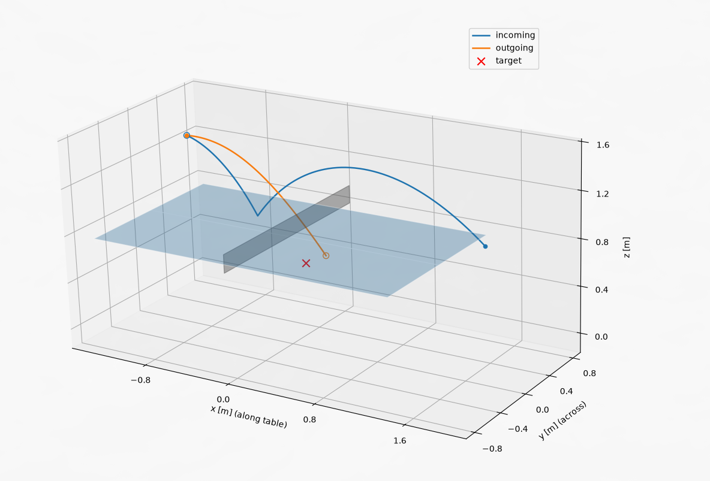
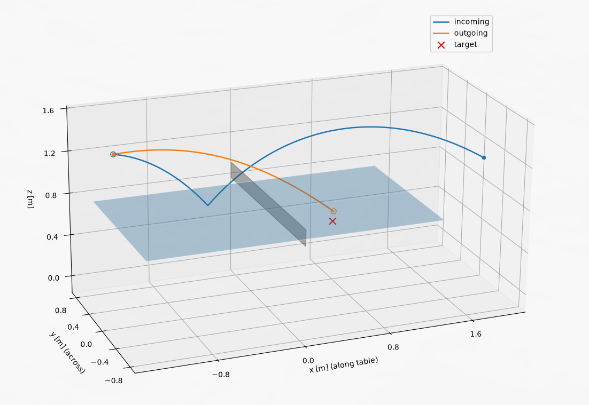

# PingPongRL

A ball-only table tennis simulator and a reinforcement learning agent that learns how to hit the ball back with a racket.

The design follows Tebbe et al., [*Sample-efficient Reinforcement Learning in Robotic Table Tennis*](https://arxiv.org/abs/2011.03275). The agent makes **one decision per incoming ball**: given the ball's state when it reaches the robot, it picks the racket's orientation and speed. In this simulator there is no robot model; the racket is assumed to reach exactly the commanded state.

<!-- Hero image: one rally in 3D. Run `python visualize.py <seed>` and save the window. -->



## How it works

Each episode is one ball:

1. **Launch.** A launcher on the human's side shoots a random return or serve (random position, speed, angle and spin). Balls that break the rules (net, out, double bounce) are resampled.
2. **Incoming flight.** The ball flies and bounces on the robot's side until it crosses a fixed **hitting plane**, 10 cm in front of the robot's end of the table. Its state there is what the agent observes.
3. **Decision.** The agent outputs the racket's two angles and its speed.
4. **Hit and outgoing flight.** The racket contact is applied, and the ball flies until it lands, hits the net or goes out.
5. **Reward.** The agent is scored by how close the ball lands to a random target on the human's side.

### Physics

- **Flight:** an RK4 integrator with `dt = 1 ms` for `a = g − k_D|v|v + k_M(ω × v)`. The drag and Magnus coefficients are computed from the ball's size and mass and the air density. Spin is constant during flight.
- **Table bounce:** the vertical velocity flips and is scaled by a restitution coefficient.
- **Racket contact:** in the racket's frame, the normal velocity is reflected with restitution `e_r` and the tangential part is kept. Spin passes through unchanged.
- **Events:** table, net, floor and hitting-plane crossings are detected between steps and located exactly by linear interpolation.

**Coordinates:** the origin is on the floor under the centre of the table (below the net). x runs along the table (robot at x < 0, human at x > 0), y runs across it, and z points up.

### RL formulation

| | |
|---|---|
| **Observation** (11) | the ball's position, velocity and spin at the hitting plane, plus the target (x, y), each scaled to roughly ±1 |
| **Action** (3, in [−1, 1]) | racket tilt α ∈ ±20°, racket turn β ∈ ±30°, racket speed ∈ [0, 2] m/s along its normal |
| **Reward** | `−landing_error − w_v·|v_z| − fault_penalty`, where `w_v·|v_z|` is a small penalty for steep, smashable balls, applied to valid landings only |
| **Episode** | one step (a contextual bandit) |

<!-- The agent is trained with SAC from [Stable-Baselines3](https://stable-baselines3.readthedocs.io/) through a [Gymnasium](https://gymnasium.farama.org/) environment. -->

## Project structure

```
src/
  constants.py   physical constants, table geometry, reward weights
  physics.py     flight (RK4), event detection, table bounce, racket hit, simulate_incoming/outgoing
  launcher.py    random serves and returns
  gym.py         PingPongEnv, the Gymnasium environment
  plot.py        3D/side-view trajectory plots and landing maps
train.py         trains a SAC agent and saves it to models/
compare.py       evaluates the fixed action vs. the trained agent on the same seeded balls
visualize.py     plays one ball with the trained agent and shows it
models/          saved agents
```

## Getting started

```bash
python -m venv .venv
source .venv/bin/activate
pip install numpy matplotlib gymnasium
pip install torch --index-url https://download.pytorch.org/whl/cpu   # CPU build is enough
pip install stable-baselines3

python train.py           # train an agent
python compare.py         # fixed action vs. trained agent, with landing maps
python visualize.py       # one random ball
python visualize.py 42    # the ball for seed 42
```

The simulation is pure Python and runs at about 8 balls per second, so training on 5,000 balls takes around 10 minutes.

## References

- D. Tebbe, L. Krauch, Y. Gao, A. Zell, *Sample-efficient Reinforcement Learning in Robotic Table Tennis*, arXiv:2011.03275.
- O. Koç, G. Maeda, J. Peters, *Online optimal trajectory generation for robot table tennis*, Robotics and Autonomous Systems, 2018.
- D. Büchler et al., *Learning to Play Table Tennis From Scratch using Muscular Robots*, arXiv:2006.05935.
- The physical constants were adapted from [dryanguasr/TableTennis](https://github.com/dryanguasr/TableTennis).
